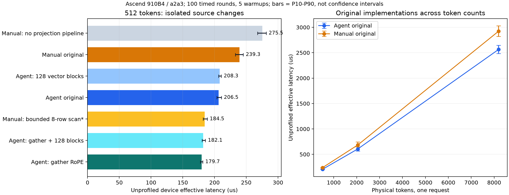
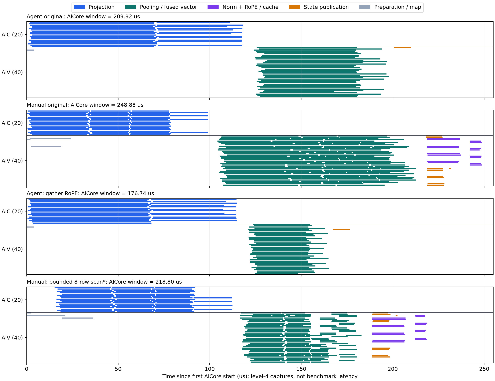
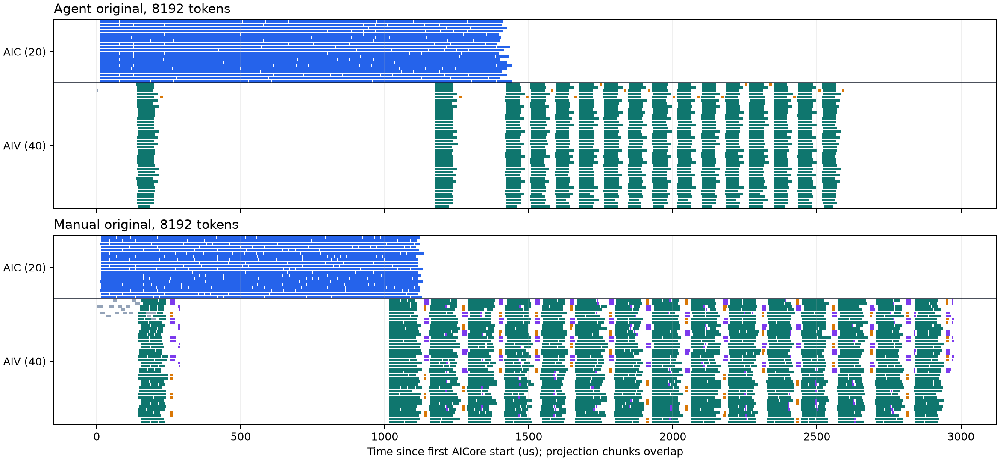

# DeepSeek V4 Flash DSpark Prefill Compressor Ratio-4 性能差异研究

研究日期：2026-10-14。研究对象为 [agent v1](deepseek_v4_flash_dspark/prefill_compressor_ratio4_v1.py) 和[手写版本](../../../models/deepseek_v4_flash_dspark/prefill_compressor_ratio4.py)。本文保留两个原文件，所有消融实验均在独立副本中进行；没有修改 PyPTO、runtime、PTOAS 或 PTO ISA。

## 1. 结论与测量结果

**当前这两个文件在本机的实际排序与上一份 SWA 研究不同：默认 512-token 输入下，agent 版本更快，206.5 µs 对 239.3 µs，延迟低 13.7%，加速比 1.159。** 2,048 和 8,192 tokens 下仍保持这一排序。本文解释当前检出的具体版本，不把“手写优化版”这个名称当作性能结论。

两者各有明显优势和缺点：

- **手写版的投影更好。** 它用较小的 N tile、共享 X 的 KV/score 双投影和两级 K 流水。默认捕获中，投影 AICore 阶段跨度为 99.06 µs，agent 为 117.16 µs。关闭手写投影的 K 流水，完整算子从 239.3 增至 275.5 µs。
- **手写版的池化存在明显标量扫描成本。** 每个压缩输出扫描整个 512-row tile；默认输入只需检查至多 8 个候选。只收窄该循环，完整算子从 239.3 降至 184.5 µs；池化 PMU scalar busy 从 80.1% 降至 27.2%。此实验依赖连续 position 与完整有效映射，不能直接推广为通用实现。
- **agent 的融合后处理有实际收益，但 RoPE 的指令选择较差。** 它使用固定窗口向量计算，并把 pooling、RMSNorm、RoPE、cache write 放在同一个向量 kernel 中。把 RoPE 的 scatter 改为等价 gather，完整算子从 206.5 降至 179.7 µs；融合阶段 scalar busy 从 47.0% 降至 17.1%。
- **“任务再切细一些”不是当前默认输入的首要答案。** agent 的向量 block 数从 40 增至 128，耗时为 208.3 µs，没有改善。两版的大阶段都已经使用全部 20 个 AIC 或 40 个 AIV。
- **长输入的额外问题是投影完成顺序与有序消费不匹配。** 多个 chunk 的投影交错执行，而池化/状态发布必须按序推进。8,192-token 泳道出现明显的中段向量空窗；agent 还在后续 chunk 重算重叠投影行。这些是进一步实验的方向，本文没有把潜在收益写成已实现收益。

| 单请求 token 数 | agent 中位数 / µs | 手写中位数 / µs | agent 延迟降低 | 手写 / agent |
| --- | ---: | ---: | ---: | ---: |
| 512 | 206.5 | 239.3 | 13.7% | 1.159 |
| 2,048 | 605.6 | 683.9 | 11.4% | 1.129 |
| 8,192 | 2,563.8 | 2,922.7 | 12.3% | 1.140 |



图中横线/误差棒为同一进程 100 轮的 P10–P90，**不是跨进程置信区间**。星号表示有额外输入前提的 scan-8 消融。原始摘要和来源 hash 见[测量 CSV](research_assets/compressor_ratio4_measurements.csv)。

## 2. 评测契约与证据边界

### 2.1 工具链与输入

| 项目 | 本次配置 |
| --- | --- |
| 设备 / 平台 | Ascend 910B4 / `a2a3`，由 `npu-run` 分配，程序使用逻辑设备 0 |
| 实际拓扑 | 20 AIC + 40 AIV，来自 capture metadata |
| Python / CANN | conda `pypto`，Python 3.11.15 / CANN 9.0.0 |
| pypto-lib HEAD | `d6cbf967bcf0d4b4bc412467cf28c944e26b1362` |
| PyPTO | `ee49fceaa3290cf90257a22eab867c04245b499d` |
| runtime / simpler | `6e383fc57c12a8bd4dce045289b8b4f5d55a15f1`，与 PyPTO gitlink 一致 |
| PTOAS | 0.65，与 `toolchain/versions.env` 一致 |
| PTO ISA | `c0d7148e95ef73bd12a73165fdce4b723a3b7e72`，与 runtime pin 一致 |
| 请求 / 起始位置 | 一个请求，`query_start_loc=[0,T]`，`start_pos=0` |
| 输入 X | `[T,4096]` BF16 |
| KV、score 权重 | 各 `[1024,4096]` BF16，总计 16 MiB |
| HEAD / RoPE / ratio | 512 / 64 / 4，压缩窗口长 8 |
| 物理 state tile | 512 tokens |
| state / cache | `[512,2,2048]` FP32 / `[8192,32,1,512]` BF16 |
| RNG seed | `20261014` |

两个模块的规格名称、顺序、shape、dtype 及关键维度逐项断言一致。**全部测试统一使用手写模块的 `build_tensor_specs` 和 `golden_prefill_compressor_ratio4`**，避免参考函数、输入分布或 comparator 不同制造假差距。每个 token 数只生成一次输入和 golden，另一版本与消融复用同一个快照。

原文件 SHA256：

```text
agent   4c7151590d7406116601949bc0604aaac4ee519c078a5c905b89f709a08196ba
manual  d2cca4d12fac58b50a61262cd8104f04435eb6cdcaf56ea63e101174afafafd2
```

两项输出均要求零超限元素：

```text
compress_state: atol=1e-3, rtol=1e-3, max_error_ratio=0
cmp_kv:         atol=1e-4, rtol=1/128, max_error_ratio=0
```

原始两版在三个 token 数下均通过；表中每个有效消融也通过同一套比较。PASS 表示满足上述容差，不等于 FP32/BF16 每个 bit 一致。

### 2.2 三种时间分别使用

1. **无插桩 device effective latency**：`PYPTO_BENCH=1`，100 timed rounds、5 warmups，报告 `[RUN] effective_us` 的 `median=`。全部速度比较使用这一口径。
2. **AICore window**：官方 reader 拼接时钟后，最早 AICore start 至最晚 AICore end。用来分析执行路径，不含前面的编排/提交与后面的 FIN 尾部。
3. **dispatch→FIN window**：pfdb 的 `makespan_us`。默认 agent 为 213.12 µs、手写为 252.78 µs，不能与无插桩 benchmark 相减计算优化收益。

芯片泳道使用显式 level 4，依赖图与干净 timing 分开采集。使用 runtime 官方 `read_perf_data()` 拼接时钟，pfdb 调用 runtime 关键路径算法；既有 CP-ROW-001 兼容只在私有临时副本中规范化行宽。没有修改原记录或 runtime。

七组用于路径分析的捕获全部检查了 `raw AICore rows == raw AICPU rows == joined rows`，以及每个 task 的行数等于 `block_num × active kernel slots`。行数分别为：74、220、74、220、220、1,169、3,490。PMU 单独采集，各管线比值采用 `sum(pipe_cycles) / sum(pmu_total_cycles)`；管线可以重叠，比值不能相加为 100%。

本次每个配置只运行一个含 100 轮的 benchmark 进程，不提供跨进程 bootstrap CI；共享设备池分配的卡可能不同。2,048/8,192-token 的轮间波动明显大于 512-token，不能把表中的小数理解成跨机器稳定常数。

## 3. 代码结构比较

| 阶段 | agent v1 | 手写版本 |
| --- | --- | --- |
| 投影 | M=128、N=256、K=512；KV 与 score 分开分配工作；8 段显式 load/matmul | M=128、N=64、K=512；单 block 共享 X 计算 KV 与 score；`pl.pipeline(..., stage=2)` |
| 投影 grid，T=512 | 32 blocks | 64 blocks |
| 压缩输出定位 | 每 lane 扫本 lane 的物理 token，读取 cmp mapping | 单 kernel 扫 tile 构造 write maps |
| 池化 | 每个输出加载 16 行，分别计算前/后四 token 的 masked exp 与列规约 | 每个输出准备 8 行；扫描整个 tile overlay 当前投影，再执行 online softmax |
| 向量 grid | 40 blocks，每 lane 约 13 tokens，其中 3–4 个压缩输出 | pooling 128 blocks，每 block 一个压缩输出 |
| RMSNorm / RoPE / cache | 与 pooling 在同一 kernel；scatter 组装旋转向量 | 8 blocks，每 block 16 个输出；gather；独立 cache write |
| state 发布 | 单向量 kernel 发布最后 8 行 | 8-block 发布 + 单 block order commit，可与 final stage 重叠 |
| 默认 timed tasks / 物理行数 | 4 / 74 | 9 / 220 |

这里的 timed task 指一条 runtime task，SPMD 的多个 block 计为多条物理行；不能把 32/64 blocks 说成 32/64 次 Python 调用。

代码依据：[agent 投影与 block 组织](deepseek_v4_flash_dspark/prefill_compressor_ratio4_v1.py#L156-L218)、[agent pooling 与后处理](deepseek_v4_flash_dspark/prefill_compressor_ratio4_v1.py#L219-L409)、[手写投影](../../../models/deepseek_v4_flash_dspark/prefill_compressor_ratio4.py#L110-L145)、[手写 scan overlay 与 online softmax](../../../models/deepseek_v4_flash_dspark/prefill_compressor_ratio4.py#L270-L359)、[手写发布与后处理](../../../models/deepseek_v4_flash_dspark/prefill_compressor_ratio4.py#L365-L496)。

## 4. 默认输入的完整关键路径

下表的 task span 为 joined AICore `max(end)-min(start)`；Observed contribution 为官方算法分配的非重叠路径贡献。默认输入两者相等。不要把 pfdb PATH 中包含 dispatch/FIN 边界的 `wall_us` 当成同一个指标。

### 4.1 agent

| 顺序 | Task | Task ID | AICore span / µs | Observed contribution / µs | 前间隔 / µs | 类型 |
| --- | --- | --- | ---: | ---: | ---: | --- |
| 1 | `prefill_c4_proj` | 4294967297 | 117.16 | 117.16 | —；front 0.92 | front-gap |
| 2 | `prefill_c4_tile` | 4294967298 | 73.92 | 73.92 | 5.94 🐌 | data-wait |
| 3 | `prefill_c4_publish` | 4294967299 | 9.38 | 9.38 | 2.60 🐌 | data-wait |

Static CPM = **200.46 µs**；Observed compute = 200.46、stall = 9.46，合计 **209.92 µs AICore window**。RoPE index prepare 为 4.08 µs，与投影重叠，未进入最终路径。

### 4.2 手写版

| 顺序 | Task | Task ID | AICore span / µs | Observed contribution / µs | 前间隔 / µs | 类型 |
| --- | --- | --- | ---: | ---: | ---: | --- |
| 1 | `prefill_c4_kv_score_proj_full` | 4294967297 | 99.06 | 99.06 | — | front-gap |
| 2 | `prefill_c4_softmax_pool` | 4294967299 | 108.66 | 108.66 | 5.14 🐌 | data-wait |
| 3 | `prefill_c4_rmsnorm_rope` | 4294967302 | 18.40 | 18.40 | 5.94 🐌 | data-wait |
| 4 | `prefill_c4_cache_write` | 4294967303 | 6.76 | 6.76 | 4.92 🐌 | data-wait |

Static CPM = **232.88 µs**；Observed compute = 232.88、stall = 16.00，合计 **248.88 µs AICore window**。write-map 的 16.40 µs、index prepare 的 22.26 µs 被投影覆盖；state publish 和 commit 在本次捕获中与后处理重叠，未决定单 tile 最终结束。

这组捕获的 38.96 µs AICore window 差异可以核算为：

```text
手写投影优势                         -18.10 µs
手写路径上的向量阶段减去 agent 向量路径 +50.52 µs
路径间隔差异                          +6.54 µs
合计                                 +38.96 µs
```

这是**该组 level-4 捕获的路径预算**，不是无插桩 32.8 µs 差距的精确分摊。不能把观测开销、前后测量边界和路径变化混在一起。



每个面板从该次捕获的首个 AICore start 对齐。scan-8 面板有较大的前部空窗；该次采集的完整窗口为 218.80 µs，不能据此否定无插桩 184.5 µs。消融的因果结论以无插桩成对结果为主，泳道解释具体阶段。

### 4.3 所有超过 1 µs 的默认路径间隔

| 版本 / 消费者 | producer END→FIN | FIN→dispatch | dispatch→receive | receive→start | 合计 / µs |
| --- | ---: | ---: | ---: | ---: | ---: |
| agent / fused tile | 1.18 | 4.10 | 0.28 | 0.38 | 5.94 |
| agent / publish | 0.64 | 1.36 | 0.14 | 0.46 | 2.60 |
| 手写 / pool | 1.16 | 2.90 | 0.22 | 0.86 | 5.14 |
| 手写 / RMSNorm/RoPE | 0.32 | 4.88 | 0.36 | 0.38 | 5.94 |
| 手写 / cache write | 1.40 | 2.62 | 0.54 | 0.36 | 4.92 |

这些消费者均没有时间戳证明的 early dispatch；依赖中存在未标记 early-resolve 的实际 producer，结构上不满足完整 speculative dispatch 条件。FIN→dispatch 是测得的普通 ready 后调度延迟，不能凭相邻任务名称指定一个“抢占者”。这里也没有完成 running/pending descriptor 全容量证明，因此不声称已证明某个任务阻塞全芯片 dispatch。

大阶段交界主要是投影完成后的真实数据等待与 ready 后调度。5 µs 级间隔值得后续优化，但当前 pool 的 108.66 µs 和 agent tile 的 73.92 µs 更大；先减少 kernel 内成本更有依据。

## 5. 哪些经验因素得到了消融支持

### 5.1 池化：消除无用标量扫描，比盲目加核更有效

手写池化每个压缩输出执行 `for pool_local in pl.range(tile_rows)`，逐行读取 state mapping 和 position，再检查是否属于当前窗口。512 tokens 产生 128 个输出，因此有 **65,536 次候选迭代**，主要分支条件需要约 131,072 次标量读。只有窗口内至多 8 行会贡献向量计算。

scan-8 实验只改变循环边界，保留判断、8-row online softmax、128-block grid、RMSNorm/RoPE 和 cache write：

```python
pool_src = pl.cast(pl.read(write_src_map, [0, write_i]), pl.INDEX) - tile_base
for pool_local in pl.range(pl.max(0, pool_src - STATE_LEN + 1), pool_src + 1):
    # Existing overlay body is unchanged.
```

在本次连续 fixture 中，候选迭代从 65,536 降到 **1,020**；完整算子 **239.3→184.5 µs**，减少 54.8 µs / 22.9%。level-4 pool 阶段 108.66→66.32 µs。收益不能全部归于降低 HBM 带宽：PMU 明确显示原始主要是 scalar busy。

| 手写 pool | Scalar busy | Vector busy | MTE2 busy |
| --- | ---: | ---: | ---: |
| 原始 | 80.1% | 10.3% | 17.7% |
| scan-8 | 27.2% | 21.0% | 51.6% |

比值的变化也受总 cycles 缩短影响；MTE2 百分比上升不等于读取字节增加。这个实验验证的是**无用候选扫描确实昂贵**。

输入限制很重要：physical token 邻近性不一定等于 absolute position 邻近性；非连续 position、任意 slot mapping、多请求边界必须重新证明候选集合。通用方案应提供可证明正确的候选索引，或保留通用路径，不能直接删掉扫描。

### 5.2 RoPE：一个 DSL scatter 并不等于一条高速向量指令

agent 用一次 swap scatter、两次 cos scatter、两次 sin scatter 构造旋转向量。生成的 A2/A3 C++ 中，该片段包含 **10 处 `TSCATTER` 调用点**；数据与有效位置的处理会展开，源码层的调用数不足以反映实际成本。

当前 pin 的 A2/A3 `TScatterImpl` 对索引逐项执行 UB 标量读写，并有标量/向量同步。这与“64 维很小，应该没有成本”的直觉相反。gather 实验利用 swap 索引是自逆置换、cos/sin 用 dup 索引复制的性质，保留其他所有阶段：

```python
swp = pl.gather(rope_t, dim=-1, index=rswp)
cos2 = pl.gather(cos_h, dim=-1, index=rope_dup_idx_template[0:1, 0:ROPE_HEAD_DIM])
sin2 = pl.gather(sin_h, dim=-1, index=rope_dup_idx_template[0:1, 0:ROPE_HEAD_DIM])
```

完整算子 **206.5→179.7 µs**，减少 26.8 µs / 13.0%。level-4 fused tile 从 **73.92→44.02 µs**，投影仍约 114–117 µs。PMU 进一步支持成本来自原来的标量路径：

| agent fused tile | Scalar busy | Vector busy | MTE2 busy |
| --- | ---: | ---: | ---: |
| 原始 scatter | 47.0% | 32.8% | 15.9% |
| gather | 17.1% | 53.4% | 29.1% |

这不是“降低抽象层次才快”的证据，而是**必须检查当前后端如何实现具体操作**。同一数学置换在当前 pin 上存在不同执行路径。

第一方实现依据：PTO ISA pin `c0d7148e` 的 `include/pto/npu/a2a3/TScatter.hpp` 中 `TScatterImpl` / `TScatterMaskImpl`；生成证据为本地 `agent/kernels/aiv/prefill_c4_tile.cpp`。计数和 PMU 结果固定在本研究工件中，不假设未来 pin 保持同样实现。

### 5.3 投影：tile、复用、流水要一起看

原始投影的数学 FLOPs 相同，T=512 时两个 GEMM 共约 **8.59 GFLOPs**。但组织方式不同：

| 投影指标 | agent | 手写 |
| --- | ---: | ---: |
| M / N / K | 128 / 256 / 512 | 128 / 64 / 512 |
| block 数 | 32 | 64 |
| L0C/Acc 地址高水位 | 128 KiB | 64 KiB |
| L1/Mat 地址高水位 | 384 KiB | 512 KiB |
| 生成的 L0 K tile | 64 | 128 |
| AICore 阶段跨度 | 117.16 µs | 99.06 µs |
| PMU Cube busy | 36.2% | 46.7% |
| PMU MTE1 busy | 24.4% | 49.9% |
| PMU MTE2 busy | 50.9% | 74.7% |

地址高水位来自 emitted `.pto` 的 tile 地址加物理大小，并非运行时缓存命中率；共享/转置别名不能重复求和。本文没有把不存在的 allocator memory report 当作证据。

手写每次 K 迭代只加载一次 X，再用于 KV 与 score，N tile 更小，Acc 空间允许两个 accumulator；两级 pipeline 为下一次 load 留出重叠空间。agent 的大 N tile 把单个 accumulator 做到 128 KiB，但没有对应的 K 级 software pipeline，后端又将 L0 K 切成 64。

**“缓存/寄存器占满”不等于“吞吐率更高”。** 手写版本使用更多 Mat 缓冲，却同时得到更高 Cube/MTE busy 与更短投影。

严格配对实验只把 full projection 的 `pl.pipeline(0, D // K_TILE, stage=2)` 换成 `pl.range(0, D // K_TILE)`，其余代码、N tile、grid、池化均保留。结果 **239.3→275.5 µs**；捕获的投影从 **99.06→122.82 µs**，pool 约 108.64 µs，与原始基本相同。这证明手写流水有效。它没有分别量化 X 复用和 N tile 各自的独立收益，三者收益不可自行相加。

### 5.4 粒度：已经用了所有核，增加 blocks 仍可能无效

| agent 消融 | 中位数 / µs | 对应基线 |
| --- | ---: | --- |
| 原始 40 vector blocks | 206.5 | — |
| 128 vector blocks | 208.3 | 相对原始未见改善 |
| gather，40 blocks | 179.7 | — |
| gather，128 blocks | 182.1 | 相对 gather 未见改善 |

40-block 默认每 lane 处理约 13 个 physical tokens，其中 3–4 个实际压缩输出；128-block 则每 lane 4 tokens，通常一个输出，但需要在 40 个 AIV 上分波执行。更细粒度可以减小单 block 工作量，也会增加 descriptor、拾取、局部初始化与尾波成本。当前结果不支持优先增加 grid。

pooling 阶段的 occupancy 也不能直接当速度指标：手写原始 pool 的 `sum(row busy)/(40 × stage span)` 为 **85.3%**，scan-8 为 **65.7%**，但 scan-8 更快。agent 原始 fused stage 为 76.6%，gather 为 75.3%，延迟同样下降。**忙着做无用扫描或慢指令，也会得到漂亮的忙碌率。**

## 6. 融合究竟贡献了多少

agent 已经做了比较积极的向量融合；手写则有 pool→RMSNorm/RoPE→cache write 三段。默认手写路径还多出若干 ready/dispatch 间隔及中间 GM 缓冲。

不过，本文没有做保持池化算法、数值路径、block 组织完全相同的单独“融合开关”实验，所以**不能把 32.8 µs 原始 gap 全归于融合**。实际上，手写只缩短扫描就能以 184.5 µs 超过原始 agent，说明 kernel 内算法成本足以改写结论。

融合也有代价：agent 每个输出对两组各 16 行做 exp/reduction，而真正有效池化位置总计只有 8 行；RMSNorm 又把 `[1,512]` 展开到 `[16,512]`。这些冗余有时被向量吞吐和较少的阶段边界抵消，不能只按 FLOPs 大小排序。

优化决策应同时看：**候选查找复杂度、后端指令路径、tile 布局与流水、阶段边界成本**。本次最强的两项证据是 scan-8 与 gather；二者分别优化两份原实现，不能把 54.8 与 26.8 µs 相加成一个完整算子的已测收益。

## 7. 长 prefill：跨 chunk 完成顺序和有序状态链



两版外层都以 512 tokens 分块，但外层循环不是设备端“上一 chunk 全部做完才开始下一 chunk”的简单串行循环：runtime 可以提交后续独立投影，多个 chunk 的 AIC blocks 在实际时序上交错。pooling 与 state publication 则受到状态依赖约束，需要按消费顺序推进。

agent 的 8,192-token 捕获中，以首个 AICore start 为 0：

| Chunk（从 0 开始） | 投影开始 / µs | 投影结束 / µs | pool 开始 / µs | pool 结束 / µs |
| --- | ---: | ---: | ---: | ---: |
| 0 | 10.52 | 127.98 | 138.16 | 216.62 |
| 1 | 78.74 | 1,165.54 | 1,172.66 | 1,252.50 |
| 2 | 323.68 | 1,411.50 | 1,417.94 | 1,488.02 |
| 3 | 128.04 | 1,307.24 | 1,505.54 | 1,574.36 |

chunk 3 的投影开始早于 chunk 2，且更早结束；pool 仍按 chunk 2→3 推进。**第二 chunk 投影的 1,086.80 µs 是这个 SPMD task 跨多个 block 的跨度，绝不是单个 matmul block 连续算了 1 ms。** 因此长序列不能把各 task span 相加成总 latency，也不能沿用单 tile 的简单阶段预算。

手写第二 chunk 的 projection 约从 134.70 到 1,005.68 µs；同样出现前段向量空窗。官方 Observed 路径会包含 `core-wait` 及有序 state 发布链。全部路径保存在[关键路径 CSV](research_assets/compressor_ratio4_critical_paths.csv)，不是只抽取一条漂亮的短路径。

| 8,192-token 捕获指标 | agent | 手写 |
| --- | ---: | ---: |
| AICore window | 2,595.14 µs | 2,975.80 µs |
| Static CPM | 2,248.40 µs | 2,656.00 µs |
| Observed contribution 合计 | 2,473.20 µs | 2,784.30 µs |
| Observed stall 合计 | 121.94 µs | 191.50 µs |
| Observed path task 数 | 32 | 47 |
| 全窗口 AIC occupancy | 53.3% | 35.9% |
| 全窗口 AIV occupancy | 33.5% | 49.3% |

Observed contribution 遵循 runtime 对 task frontier 的定义；SPMD task 内的排队和分散启动可能进入其跨度，不能称为纯硬件计算时间。两种引擎的 occupancy 分母分别是 20 和 40 个核，也不能相加。

另外，agent 对后续 chunk 设置 `scratch_row0=base-16`，将 528 个有效投影行按 M=128 向上取整成 5 组。最后一组通过 clamp 回到 chunk 尾部，与前一组重算部分行；每个后续 512-token chunk 实际执行 640 行等价投影工作。单个后续 chunk 为 **25% 冗余投影 FLOPs**；16 chunks 总体为 `(512+15×640)/(16×512)-1 = 23.4%`。这不等于总 latency 必然增加 23.4%，因为两引擎重叠及状态链会改变关键路径。

由此得到两个有依据但尚未验证的方向：

1. 限制投影 lookahead，或确保近期要消费的 chunk 先完成，减少“后续投影在忙，当前 pool 在等”的空窗。必须通过独立实验权衡串行约束损失的重叠；本文未证明 descriptor 全容量饱和，也未归因于某个确定的 runtime 调度缺陷。
2. 复用上一 chunk 已有的投影/状态前缀，避免完整 M=128 的重算。必须保留 absolute position、state mapping 与状态发布顺序。

## 8. 数值契约、失败实验和不能推出的结论

agent 的池化路径有 `minimum(score,20)`、分母加 EPS，与手写 online softmax 不完全是同一个数学表达式。它还利用 physical token 邻接关系定位窗口，手写通用扫描则按 position 和 mapping 选择候选。因此本研究的性能比较成立于**三个已通过相同 golden 的单请求连续 fixture**；没有证明任意 packed request、缺失 state slot、非连续 position 或极端 logits 下全面等价。

有三类实验/采集问题明确排除：

- **RMS 单行替换没有有效性能结果。** 首次尝试遗漏 Tile row-reduction 要求的 scratch 参数；补齐后，该直接 Tile 路径在当前布局下触发 `col-major none_box ... rows * sizeof(dtype) ... 32-byte aligned, but got 4 bytes`。这说明不能只缩小 shape 而忽略物理布局；没有据此认定框架有 bug。
- **双投影共享流水与 agent 后处理组合的研究副本未通过 cache 校验。** state 通过，但 cache 有 3,071 个超限元素，最大绝对误差 4.21875。原因未定位，不归因为编译器问题，也不列入性能表；禁止放宽容差后冒充有效优化。前文对手写投影优势的论断依赖原始捕获与合法的 no-pipeline 对照。
- **采集生命周期问题。** PMU 与 benchmark loop 同开时，一次在 validation 通过后触发 `halHostRegister for PMU SHM failed: 8`；改为独立 PMU-only 新进程采集通过。多 case profile 进程的后续 dep-gen 子进程也曾 exit 1，clean timing 与正确性仍通过；使用保留下来的 spec 在独立进程执行官方 `_dep_gen_capture`，四份依赖图均恢复成功，再检查全部 row counts。原错误日志保留，未用不完整图作路径分析，也未改动原 timing JSON。当前证据不足以判定这些故障的根因。

没有做指令级模拟器采集，本文的指令判断来自 pinned PTO ISA 源码、实际生成 C++、PMU 以及真实设备消融；没有把源码循环次数换算成未经测量的纳秒。没有验证跨平台、跨工具链、真实模型权重和完整模型上下文中的收益。

## 9. 优先级建议与 agent 可复用的经验

| 优先级 | 方向 | 已有依据 | 下一步验收条件 |
| --- | --- | --- | --- |
| 1 | agent RoPE 使用合适的 gather 路径 | 完整算子 -26.8 µs；scalar busy 下降；其余阶段保留 | 扩展非默认 position / packed request / 极端数值校验后再合入 |
| 1 | 手写 pooling 提供有界、正确的候选定位 | 连续 fixture 的 scan-8 完整算子 -54.8 µs | 候选索引必须覆盖通用 mapping，不能把 fixture 假设藏入算子 |
| 2 | agent 投影参考手写 N tile、X 复用和 K 流水 | 手写 projection 更快；关流水有明确回退 | 单独替换投影并先通过原容差；当前组合副本失败，不应直接采用 |
| 2 | 长序列投影提交顺序 / 有限 lookahead | 8,192-token 泳道的中段空窗与投影交错 | 比较无插桩 wall time，同时核验状态依赖与输出 |
| 2 | 消除后续 chunk 重复投影 | 后续 chunk 25% 冗余 FLOPs 的结构证明 | 正确复用前缀；报告总 latency，不只报告 FLOPs |
| 3 | RMS 布局重写、更多向量 blocks、early resolve | RMS 直接缩小未编译；加 blocks 无改善；路径间隔约数 µs | 需要独立有效实验，不以“看起来更并行”作为接受理由 |

这次值得带回 agent 开发流程的经验是：先确认实际性能排序与数值边界；找到关键阶段后，沿源码追到生成代码和指令实现；通过只改一个因素的实验区分“用核数”“做有用工作”和“完成得更早”。扫描 512 行和访问 8 个候选都能占满 AIV，但代价完全不同；一个小 scatter 也可能比它周围的大向量算术更值得优化。

## 10. 复现与工件

可复用入口为[研究 harness](research_assets/compressor_ratio4_gap.py)，它直接导入原文件，使用手写规格与 golden，检查 ABI/常量并记录 source SHA。它是独立测量入口，不属于 pfdb 的数据采集功能。

在仓库根目录、激活 `pypto` 环境后运行；以下示例写入新的目录，保留本研究原捕获：

```bash
conda activate pypto
export PYPTO_BENCH=1 PYPTO_BENCH_RAW=1
export PYPTO_BENCH_ROUNDS=100 PYPTO_BENCH_WARMUP=5

npu-run python benchmarks/implementation/deepseek-v4.1-flash/research_assets/compressor_ratio4_gap.py \
  benchmarks/implementation/deepseek-v4.1-flash/deepseek_v4_flash_dspark/prefill_compressor_ratio4_v1.py \
  build_output/compressor_ratio4_repro/agent

npu-run python benchmarks/implementation/deepseek-v4.1-flash/research_assets/compressor_ratio4_gap.py \
  models/deepseek_v4_flash_dspark/prefill_compressor_ratio4.py \
  build_output/compressor_ratio4_repro/manual \
  --golden-data build_output/compressor_ratio4_repro/agent/data
```

采集泳道时关闭 benchmark，并复用已有编译：

```bash
unset PYPTO_BENCH
npu-run python benchmarks/implementation/deepseek-v4.1-flash/research_assets/compressor_ratio4_gap.py \
  models/deepseek_v4_flash_dspark/prefill_compressor_ratio4.py \
  build_output/compressor_ratio4_repro/manual \
  --golden-data build_output/compressor_ratio4_repro/agent/data \
  --runtime-dir build_output/compressor_ratio4_repro/manual --swimlane 4

export PFDB_PATH=.pfdb/compressor_ratio4_repro.duckdb
pfdb ingest build_output/compressor_ratio4_repro/manual/dfx_outputs \
  --program compressor_ratio4 --platform a2a3 --no-prune
pfdb query overview --run-id 1
pfdb query critical_path --run-id 1
```

2,048 / 8,192-token 复现为两版均加同一个 `--tokens`，每个 shape 创建自己的输入快照，禁止误用 512-token golden。PMU 使用独立进程、关闭 benchmark，传 `--pmu 2`；请使用另一个 build 副本保留已分析的捕获。

本次本地完整工件保留于 `build_output/compressor_ratio4_gap/`：`*_bench.log`、`*_profile.log`、`*_pmu.log`、输入/golden、生成 `.pto/.cpp`、研究副本及 `analysis.json`。数据库为 `.pfdb/compressor_ratio4_gap.duckdb`，run 1–7 依次为 agent、manual、agent-gather、manual-scan8、manual-no-pipeline、agent-8192、manual-8192。生成工件和数据库不纳入 Git。

可随报告保存的证据：

- [11 组有效 benchmark 摘要与 source SHA](research_assets/compressor_ratio4_measurements.csv)
- [全部 timed tasks、物理行数与时长](research_assets/compressor_ratio4_tasks.csv)
- [七份完整 Observed paths](research_assets/compressor_ratio4_critical_paths.csv)
- [原始和消融版本的 PMU 聚合](research_assets/compressor_ratio4_pmu.csv)

分析定义和适配规则见[pfdb runtime integration](../../../docs/debug-and-tune/pfdb-runtime-integration.md)；时间口径与 benchmark loop 见[测量规则](../../../.claude/rules/benchmarking.md)。
