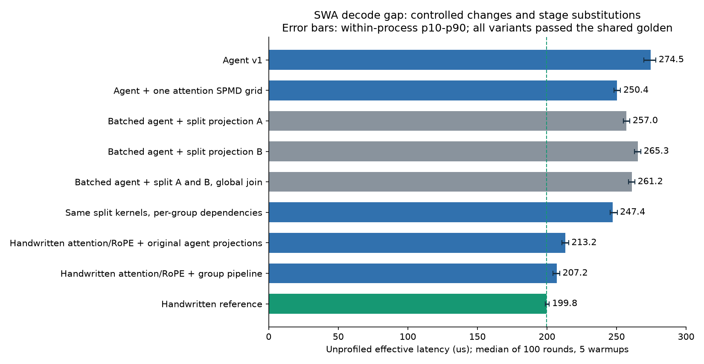
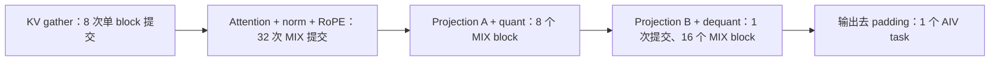
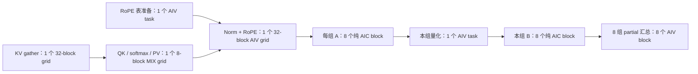
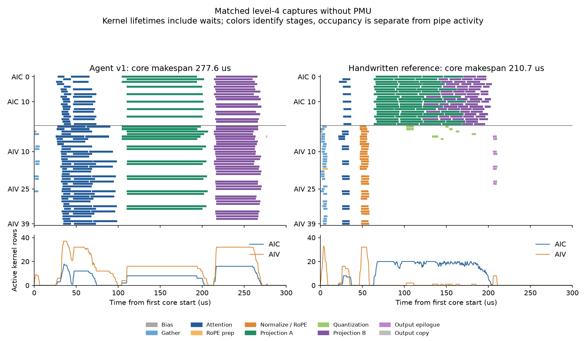
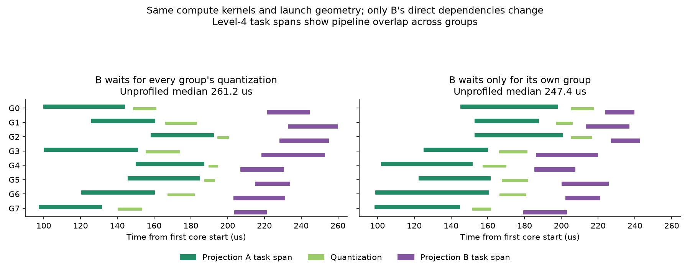

# DeepSeek V4.1 Flash MTP SWA Decode 性能差距研究

研究日期：2026-10-09。

研究对象是 [agent v1 实现](deepseek_v4_flash_mtp/decode_sparse_attn_swa_v1.py) 与 [手写优化实现](../../../models/deepseek_v4_flash_mtp/decode_sparse_attn_swa.py)。两者都使用 PyPTO DSL 和同一套编译、运行工具链。本文比较的完整算子包含滑动窗口 attention、逆 RoPE、第一层输出投影、分组 INT8 激活量化、第二层输出投影和反量化输出。

## 1. 主要发现

原始 agent v1 的无插桩中位耗时是 **274.5 µs**，手写版是 **199.8 µs**，相差 **74.7 µs**。agent v1 耗时高 37.4%，手写版的加速比是 1.374。

**主要差距集中在 attention/RoPE 前段的执行组织和底层指令选择。投影阶段的跨组依赖和流水是第二个因素。单独增加融合、增加 block 数或开启 early resolve，都不能解释和消除这个 gap。**

这不是仅从代码外观推测出的结论。研究做了同输入真机对照、两组完整芯片泳道、PMU 采集、12 个通过 golden 的完整算子配置，以及一个严格逐元素校验的 RoPE 微基准：

| 对照或改动 | 无插桩中位数 | 对原始 gap 的意义 |
| --- | ---: | --- |
| 原始 agent v1 | 274.5 µs | 基线 |
| 原始手写版 | 199.8 µs | 目标 |
| 只把 agent 的 32 次 attention 提交合成一个 SPMD grid | 250.4 µs | 节省 24.1 µs，消除原始 gap 的 32.3% |
| 使用手写 attention/RoPE 结构，保留 agent 原始融合投影 | 213.2 µs | 节省 61.3 µs，消除原始 gap 的 82.1% |
| 上述前段加分组投影流水实验 | 207.2 µs | 消除原始 gap 的 90.1%，距离手写版仅 7.4 µs／3.7% |

另一个严格配对的实验保持投影计算 kernel、tile、block 数和提交顺序不变，只把 B 投影的依赖从“所有组量化完成”改成“本组量化完成”，耗时从 **261.2 降到 247.4 µs**。依赖边的粒度本身带来 13.8 µs 的收益。

RoPE 微基准则揭示了隐藏的指令成本：对同一个 `[16,64]` 输入执行同样的逆旋转，agent 风格的 scatter 路径是 **33.6 µs**，gather 路径是 **10.8 µs**，后者快 3.11 倍。两者都以 `rtol=0, atol=0` 通过 BF16 输出比较。当前 PTO ISA 的行方向 masked scatter 实现包含逐元素标量循环。

这些收益不能相加成为一份精确的 74.7 µs 预算。SPMD 改写已经包含在前段替换里；RoPE 微基准的执行窗口与完整 attention 不同；投影流水还会改变内存竞争和任务完成顺序。本文只对成对实验本身作因果判断，对联合替换报告整体收益。



图中横线是每个配置单进程 100 轮的 P10–P90 范围，不是跨进程置信区间。灰色分支说明：看起来合理的投影拆分，在没有形成有效流水时会变慢。

## 2. 评测契约与复现条件

### 2.1 环境与输入

| 项目 | 配置 |
| --- | --- |
| 设备 | Ascend 910B4，平台 `a2a3`，逻辑设备 `-d 0` |
| 实际拓扑 | 20 个 AIC、40 个 AIV；来自捕获 metadata |
| Python 环境 | conda `pypto`，Python 3.11.15 |
| CANN | 9.0.0 |
| pypto-lib HEAD | `81c414c`，含用户已有未提交文件；没有修改两个原始算子 |
| PyPTO | `ee49fcea` |
| simpler | `6e383fc57c12a8bd4dce045289b8b4f5d55a15f1`，与 PyPTO gitlink 一致 |
| PTOAS | 0.65，与 PyPTO `toolchain/versions.env` 一致 |
| PTO ISA | `c0d7148e95ef73bd12a73165fdce4b723a3b7e72`，与 runtime pin 一致 |
| B / S / T | 4 个请求 × 2 个 token，T=8 |
| query | `[8,64,512]`，BF16 |
| SWA 窗口 | 128，默认完整窗口 fixture |
| KV cache | `[128,128,1,512]`，BF16，物理页索引输入 |
| hidden size / RoPE dim | 4096 / 64 |
| 输出投影分组 / LoRA rank | 8 / 1024 |
| `wo_a` | `[8,1024,4096]`，BF16，NZ；逻辑大小 64 MiB |
| `wo_b` | `[8,4096,1024]`，INT8，NZ；逻辑大小 32 MiB |
| 输出 | `[8,4096]`，BF16 |

两个模块的主要常量逐项核对一致，torch golden 函数除局部 import 外的 AST 对应代码一致。agent 首次通过的运行保存了 10 个输入张量和 1 个 golden 输出；手写版和完整算子实验都复用了这个快照。日志中均确认输入、输出 cache hit。

原始文件 SHA256：

```text
agent  0ed4e4bac3be06bd8b0b08b66ca49594435e6553180ff5cba3da9546200ff89b
manual a787836fb363c4b560dcb60a625f94df3a6dd5280a298a915135ef3ac1620946
```

研究结束前重新核对了两个 hash，均未变化。

### 2.2 正确性与计时

每个有效完整算子配置都通过同一个 `attn_out` comparator：

```text
ratio_allclose(atol=1e-4, rtol=1/128, max_error_ratio=0.005)
```

因此完整算子的 PASS 表示满足原入口的数值容差，不能解释为每个 BF16 元素完全相同。RoPE 微基准另外采用零容差比较。

计时配置统一为：

```text
PYPTO_BENCH=1
PYPTO_BENCH_RAW=1
PYPTO_BENCH_ROUNDS=100
PYPTO_BENCH_WARMUP=5
```

每个配置在一个新进程中完成编译、golden 检查和 100 轮计时，没有通过重复启动同一个脚本凑样本。原始两版在同一个 `npu-run` 分配内顺序运行；严格依赖配对实验也在同一分配内顺序运行。所有设备命令均经 `npu-run`，没有自行绑定物理卡。

性能数字使用 **无 profiling 的 `effective_us` 中位数**。这个指标是 runtime 的设备执行窗口，包含该窗口内的 orchestration／scheduler 活动，不包含 Python 编译、torch golden、完整主机调用时间，也不是整个模型 forward 的耗时。100 轮复用输入和权重，属于缓存已预热的重复执行场景。

泳道单独使用 **chip swimlane perf level 4**。PMU 使用另一组 level-4 + `enable_pmu=2` 捕获。PMU 会明显扰动调度，因此第 3、4 节的时间线和关键路径采用没有 PMU 的捕获，第 8 节只使用 PMU 判断管线活动。

### 2.3 原始分布

| 实现 | min | median | mean | max |
| --- | ---: | ---: | ---: | ---: |
| agent v1 | 258.9 | 274.5 | 273.9 | 282.7 |
| 手写版 | 196.7 | 199.8 | 200.1 | 208.9 |

单位均为 µs。完整实验汇总见 [CSV](research_assets/swa_gap_measurements.csv)。

## 3. 任务图与实际执行组织

### 3.1 agent 的主要路径



这里的融合是真实存在的。agent 把 attention、归一化、RoPE 放进一个 mixed region；把 A 投影和量化放进另一个 mixed region；B 投影还在每个 D tile 内遍历 8 个组，完成反量化与求和。

但 `for ... in pl.parallel` 包裹 `pl.at` 在生成的 orchestration C++ 中变成了逐次 `rt_submit_task`。attention 每个 token 4 个 head chunk，共 32 次提交；A 投影每组 1 次，共 8 次。B 虽已使用 SPMD，只有 16 个 block，每个 block 内依次处理全部 8 个组。

### 3.2 手写版的主要路径



图中 A → quant → B 有 8 条组内分支。一个组的 B 不需要等待其他组的 A 或 quant；只有最终输出汇总需要所有 B 的结果。

QK/PV 是按 token 划分的 8 个任务块，每块用 32-head matmul fragment 处理该 token 的全部 64 个头，提供核内 KV 复用机会。归一化与 RoPE 通过 GM 中间结果交给独立 AIV grid。投影 matmul 使用纯 AIC，短的量化和输出处理使用独立 AIV。

### 3.3 图规模与假串行检查

| 指标 | agent v1 | 手写版 |
| --- | ---: | ---: |
| 捕获中的 task 数 | 51 | 30 |
| 逻辑 block 总数 | 66 | 218 |
| AIC／AIV 物理执行行 | 178 | 234 |
| 依赖记录数 | 652 | 49 |
| 去重后的 `(pred,succ)` 数 | 644 | 42 |
| 同族 task 之间的依赖边 | 0 | 0 |

一个 MIX block 在本次拓扑中对应 1 个 AIC 行和 2 个 AIV 行，所以物理执行行不能与逻辑 block 混为一谈。

**v1 已经没有早期实现常见的同族 WAW／WAR 串行链。** 本研究没有发现 8 个 A 投影组被依赖串成一条链，也没有发现 32 个 attention task 之间的同族依赖。此前其他实现的“假串行”结论不能直接套在这个 v1 上。

当前图的主要限制是粗的生产者完成边界：原始 agent 每个 A 投影 task 有 34 个不同前驱，其中包括全部 32 个 attention task；B 的输入要求 8 个融合 A+quant task 全部完成。大多数前驱来自整个共享张量的注册范围。这个边界保证了当前分解的正确性，但没有表达按组尽早消费的机会。

## 4. 芯片泳道：差距出现在哪里



图的上半部是物理核心上的 kernel 生命周期，下半部是同时存在的 kernel 行数。**生命周期包含等待和同步；长条不是等量的有效计算。** 左侧融合投影的 AIV 长条需要结合第 8 节 PMU 解读。

时间以各自捕获的第一个 AICore start 为 0。主要阶段的实际 start/end 如下：

| 阶段 | agent v1 | 手写版 |
| --- | --- | --- |
| KV gather | 0.0–6.5 | 0.0–8.6 |
| attention / RoPE | 融合部分 25.7–98.7 | QK/PV 21.4–36.9；norm/RoPE 46.7–58.4 |
| RoPE 公共表 | 各 attention task 内计算／使用 | 2.4–8.9，与前段重叠 |
| A 投影／量化 | 融合部分 104.2–206.8 | A 63.5–173.4；quant 102.1–185.2 |
| B 投影 | 融合部分 213.8–271.1 | 121.8–204.1 |
| 输出 epilogue | 已在 B 内，另有 copy 276.1–277.6 | 205.4–210.7 |

单位为 µs，同一阶段有多个 block 时采用全族最早 start 到最晚 end，不能逐行相加得到总耗时。

这张表提供两个直接观察：

1. agent 的 attention/RoPE 尾端比手写版晚约 40 µs。这发生在后续投影之前，无法用投影 tile 或 B 的吞吐单独解释。
2. 手写版的 B 在 121.8 µs 已开始，而最后一个 A 到 173.4 µs 才结束，跨组重叠约 51.6 µs；B 还与后续 quant 重叠。agent 的 B 到 213.8 µs 才开始，位于所有 A+quant 完成之后。

前段输出更早，后段可跨组流水，两者一起缩短了关键执行路径。

### 4.1 核心占用与硬件利用率

| 没有 PMU 的 level-4 捕获 | agent v1 | 手写版 |
| --- | ---: | ---: |
| AICore makespan | 277.62 | 210.74 |
| AIC 生命周期总和 | 1989.08 | 2553.16 |
| AIV 生命周期总和 | 4638.34 | 672.74 |
| 平均同时存在的 AIC 行 | 7.16 / 20 | 12.12 / 20 |
| 平均同时存在的 AIV 行 | 16.71 / 40 | 3.19 / 40 |

手写版 AIC 生命周期总和更大，但总路径更短；agent 的 AIV 生命周期总和很大，但融合投影中有效 vector 活动极少。评价优化需要同时看关键路径、任务并发和 PMU，不能用“总 busy 时间下降”或“AIV 长条更多”作为性能更好的依据。

A+quant 原始只有 8 个 MIX block，最多同时占用 8/20 个 AIC 以及 16/40 个 AIV。手写版的 64 个 A block 可分多波填满 AIC，并把短量化交给空闲 AIV。这个结构支持更高的 cube 并发和组间流水。不过，第 8 节显示，只把 A 细分成 64 block，整体性能反而下降：硬件利用机会需要有匹配的依赖和后继工作，增加 block 本身不保证收益。

## 5. 原因一：提交粒度带来的调度成本

这是最小、最干净的完整算子对照。

原始 attention：

```python
for t in pl.parallel(0, T):
    for hb in pl.parallel(0, H, 16):
        with pl.at(level=pl.Level.CORE_GROUP, name_hint="swa_attn_rope"):
            # Original compute body.
```

实验改成一个 grid，内部计算体不变：

```python
with pl.spmd(T * (H // 16), name_hint="swa_attn_rope"):
    attn_idx = pl.tile.get_block_idx()
    t = attn_idx // (H // 16)
    hb = (attn_idx - t * (H // 16)) * 16
    # Same compute body.
```

结果是 **274.5 → 250.4 µs**。捕获中的 task 数从 **51 降到 20**，依赖记录从 **652 降到 62**，但物理执行行仍然是 **178**。32 个 attention block 的单块工作量没有变。

因此这 24.1 µs 的收益来自提交／任务图组织变化以及由此引起的调度，而不是更小的数学 tile 或减少注意力计算量。依赖记录的大幅减少与收益相关，但未单独测量“处理一条依赖记录”的成本，不能把 24.1 µs 全部归为某一个 scheduler 子步骤。

这里要区分三个粒度：

- **提交粒度**：多少次 orchestration submit；可以用大 grid 合并。
- **block 工作量**：每个核心处理多少 head、N、K；决定负载与本地数据复用。
- **依赖完成粒度**：消费者等待哪个 token／组／grid 完成；决定是否能形成流水。

本次 SPMD 实验改变第一个粒度，保持第二个粒度。将它描述成“切得更细”会遗漏实际机制。

## 6. 原因二：RoPE 的 scatter 是标量工作

### 6.1 从 DSL 到实际指令

agent 在每个 head chunk 中先提取偶数／奇数列，计算旋转后的两半，再通过两次 `pl.scatter(..., mask_pattern=...)` 交织回输出。

生成的 AIV C++ 出现：

```cpp
TSCATTER<pto::MaskPattern::P0101, pto::ScatterAxis::SCATTER_ROW>(...);
TSCATTER<pto::MaskPattern::P1010, pto::ScatterAxis::SCATTER_ROW>(...);
```

在本次 pin 的 PTO ISA `include/pto/npu/a2a3/TScatter.hpp` 中，这个 mask + row 方向的实现走以下逻辑：

```cpp
for (int i = 0; i < validRow; i++) {
    for (int j = 0; j < validCol; j++) {
        idx = GetIdxByMask<mask, DstTile::RowStride>(i, j);
        dstPtr[idx] = srcPtr[i * SrcTile::Cols + j];
    }
}
```

这是标量 UB 读写循环。`pl.scatter` 是 tile API，调用形式本身不能证明实现使用了向量指令。这里的结论限于当前 ISA 版本和该具体 scatter 方向／mask，不能外推到所有 scatter。

手写版将偶奇互换索引、重复 cosine 和带符号 sine 的布局提前准备好，用索引 gather 得到交换后的 rope，再进行整块乘加。它还把这套 head 不变的表准备从每个 attention chunk 的热点路径中移出。

### 6.2 指令、计数器与实测证据

| 证据 | 观察 | 可支持的判断 |
| --- | --- | --- |
| 当前 ISA 源码、生成 C++ | 行 masked scatter 落到逐元素标量循环 | 证明具体操作的实现机制 |
| 原始 agent attention AIV PMU | scalar 67.7%，vector 6.5% | 支持这一阶段有大量标量成本；不能把所有 scalar 都归给 scatter |
| 相同 `[16,64]` RoPE 的独立真机微基准 | scatter 33.6 µs；gather 10.8 µs；均零容差 PASS | 证明该数学子问题存在显著的指令选择差距 |

额外的单 kernel level-4 + PMU 捕获也完成了零容差校验和完整行数检查。scatter 的 scalar ratio 为 **85.6%**、vector 为 **5.3%**；gather 的 scalar 为 **37.7%**、vector 为 **29.6%**。两个捕获的实际 core start→end 生命周期分别为 **28.18 和 3.76 µs**。这提供了移除标量循环后的核内证据；它们属于 profiling 数据，不代替前述无插桩的 33.6／10.8 µs。

微基准的 gather 路径还在该 task 内生成索引和 cosine/sine 的重复布局，没有享受手写版跨 head 共用预计算表的全部机会。即便如此，它仍显著快于 scatter。

微基准包含单 task 的调度与执行开销，并不是完整算子中 RoPE 的独立计时。因此 **22.8 µs 的微基准差额不能乘以 32，加进完整算子的 wall time**。完整算子的多个 head chunk 并发执行，而且 mixed kernel 中有额外同步。

### 6.3 对完整算子的验证

将前段改为手写版的 token 级 QK/PV、独立 norm/RoPE grid 和公共 RoPE 表，随后把结果写入 agent 原有的 token-major `attn_heads`，保留原始 gather、原始 A+quant 和原始 B+dequant，得到 **213.2 µs**。

A／B 投影的源代码片段经字符串比较确认与原始 agent 完全一致。这项替换消除 61.3 µs，说明前段本身足以解释大部分 gap，投影全面重写不是接近手写性能的必要条件。

这个联合替换同时改变了提交形态、QK/PV 的 head fragment 与 KV 复用范围、RoPE 指令与表准备、MIX/AIV 边界，以及移入的 producer early-resolve 属性。它证明的是**前段整体结构的收益**。SPMD 和 RoPE 微基准分别提供其中两项的独立证据；本次没有给 KV 复用、每种中间布局或每条指令分配独立的 µs 贡献。

## 7. 原因三：按组释放结果，投影才能形成流水

### 7.1 数学上的依赖边界

A 的结果先做每个 `(token,group)` 的 amax 和 INT8 量化。B 的第 g 组只需要该组量化结果和该组反量化 scale。组间需要汇合的位置是最终输出：

```text
out = weight_scale × Σg (INT32_partial[g] × activation_scale[g])
```

由于每组 activation scale 不同，不能先把所有 INT32 partial 合并，再乘一个公共 activation scale。正确的窄依赖是 `A[g] → quant[g] → B[g]`，保留最终跨组求和。

agent 的 B 每个 block 在内部处理全部 8 组，所以它自然要求 8 个融合 A+quant 的结果全部到齐。手写版给每组 B 分配独立 grid，用显式 TaskId 表达组内完成边界。

### 7.2 严格依赖配对实验

为避免把 tile、matmul 或量化实现的差异误判成依赖收益，研究构造了两个计算体一致的版本。两者都使用 64 个纯 A block、8 个 quant task、64 个纯 B block，以及相同的输出 epilogue。唯一不同的一行是 B 的 `deps`：

```python
# All-group join.
deps=[quant_tids[i] for i in range(O_GROUPS)]

# Per-group dependency.
deps=[quant_tids[pb_g]]
```

| 指标 | 全组汇合 | 本组依赖 |
| --- | ---: | ---: |
| 无插桩 median | 261.2 | 247.4 |
| 捕获 task 数 | 36 | 36 |
| 逻辑 block 总数 | 194 | 194 |
| 物理执行行数 | 258 | 258 |
| 依赖记录数 | 118 | 62 |
| 第一个 B 的 core start | 203.34 | 179.46 |
| 最后一个 quant 的 core end | 200.42 | 217.60 |

µs 数来自各自 level-4 捕获；两个捕获的具体绝对时间不能代替无插桩 benchmark。前一个图中的 B 在所有 quant 结束后开始；后一个图中的 B 已与其他组的 A／quant 重叠。少掉的 56 条依赖恰好是 8 组各少等 7 个其他组。



这种流水增加了可运行工作的选择，使调度器在某个组完成后可以立即安排后继。A 和 B 都搬运权重，会竞争同一类资源；收益来自整体路径缩短，不要求每一个 A block 的孤立耗时都降低。

### 7.3 为什么单独拆融合反而变慢

在已批量提交 attention 的 agent 上：

| 改动 | median | 相对 250.4 µs |
| --- | ---: | ---: |
| 仅分离 A matmul 和 quant，并细分 A | 257.0 | 增加 6.6 |
| 仅分离 B matmul 和输出处理，并细分 B | 265.3 | 增加 14.9 |
| A、B 都分离，但仍全组汇合 | 261.2 | 增加 10.8 |
| 相同的分离计算体改为本组依赖 | 247.4 | 减少 3.0 |

单位为 µs。拆分增加了任务、GM 中间结果和 epilogue 成本。如果保留全组屏障，新增阶段缺少可兑现的重叠机会，代价就超过收益。

所以“纯 cube + 纯 vector”在手写版中有效，是它与 grid、组内依赖、布局和流水共同配合的结果。融合是一个局部成本选择，需要依据执行路径判断，不能作为单独的优化目标。

## 8. 硬件计数器与编译器资源证据

### 8.1 投影主要消耗数据搬运管线

来自独立 PMU 捕获，以各函数所有物理行的 counter 总和除以 `pmu_total_cycles` 总和：

| AIC kernel | cube | MTE1 | MTE2 | scalar |
| --- | ---: | ---: | ---: | ---: |
| agent `o_proj_a_quant_aic` | 18.6% | 58.2% | 96.3% | 14.6% |
| 手写 `proj_a_mm` | 11.2% | 34.5% | 87.5% | 10.7% |
| agent `o_proj_b_aic` | 7.8% | 21.6% | 71.0% | 26.9% |
| 手写 `proj_b_mm` | 10.9% | 32.8% | 78.0% | 13.6% |

管线能并行活动，百分比不能相加成 100%。这些 counter 支持“投影的本地执行受数据搬运影响很大”，不支持直接声称已达到整卡 HBM 峰值。MTE2 的来源可能包含 L2 命中；本研究没有采集足够的 cache／HBM 带宽 counter 来区分。

agent 的融合投影 AIV vector ratio 分别只有 **1.4%（A）** 和 **2.3%（B）**。生成代码含 cube/vector `TPipe` 与 `TPOP`。结合长的 AIV 生命周期，这支持其资源占用中有很大的等待／同步成分。仅凭这些 aggregate counter 不能断言每个等待周期都来自某一个 `TPOP`。

### 8.2 写了 stage=2，并不保证两个物理 buffer

agent A 投影出现两条编译器 `PH-MR-001` 提示。其核心原文为：

> software pipelining requested depth 2 ... in Right, but only 1 of 2 buffers fit ... stages 1 apart share storage and serialize.

该提示说明申请的 pipeline 深度与实际分配的 buffer 深度不一致。它是编译器证据，不是本研究已独立量化的性能损失。没有对这两条 hint 做一项只改变物理 buffering 的完整消融，因此不能给它分配一个确定的 µs 数。

实际 memory map 的部分占用如下，单位 KiB：

| kernel | Mat/L1 | Right/L0B | Acc/L0C | Vec |
| --- | ---: | ---: | ---: | ---: |
| agent A cube 部分 | 272 | 64 | 16 | — |
| 手写 A cube | 144 | 64 | 8 | — |
| agent B cube 部分 | 272 | 64 | 32 | — |
| 手写 B cube | 136 | 64 | 32 | — |
| agent attention AIV | — | — | — | 140.125 |
| 手写 QK/PV AIV | — | — | — | 64.75 |

编译器在该目标上的预算是 Mat 512 KiB、Right 64 KiB、Acc 128 KiB、Vec 184 KiB。这里的 Vec 是编译器可用预算，不能当成芯片物理 UB 总容量。不同 kernel 覆盖的计算范围不同，表格用于观察融合后的局部资源规模，不能单凭高占用判断哪一项是容量瓶颈。

### 8.3 任务更细不是单调更快

在手写版上进一步做反向对照：

| 配置 | 变化 | median | 观察 |
| --- | --- | ---: | --- |
| 原始手写 | A N fragment=128；B task D=512 | 199.8 | 基线 |
| A N fragment=256 | A block 从 64 降为 32 | 199.0 | 无明显性能损失；0.8 µs 不足以宣称稳定优化 |
| B task D=2048 | B block 从 64 降为 16；内部 matmul fragment 保持 256 | 200.7 | 仍接近基线，只有小幅变化 |
| A N fragment=512，K 保持 256 | 计划将 A block 降为 16 | 编译失败 | Mat 需要 540672 B，超过 524288 B |

这组证据限制了“原始 agent 只有 8/16 个 projection block，所以一切都因核心数量不足”的解释。更细分块会增加输入重复加载、FIXPIPE drain、调度波数和中间数据，必须同时满足容量、复用和流水目标。N、K 与 buffering 需要联合选择。

### 8.4 early resolve 的贡献有限

原始 agent 无具备结构资格的 early-dispatch 消费行。手写版的 clean capture 中，有 144 行具备资格，其中 **48 行由实际 dispatch 早于前驱 FIN 的时间戳证明提前派发**。producer 上的 `allow_early_resolve=True` 本身没有被当成这个证明。

将手写版全部 6 处 producer early-resolve 属性关闭后，median 为 **202.9 µs**，相对原始 199.8 µs 增加 3.1 µs。在本次形状下，这个量级明显小于总 gap。它可以打磨短阶段间隙，但无法替代前段指令选择和组内流水。

## 9. 完整消融表与机制判断

| 实验名 | 内容 | median | mean | golden |
| --- | --- | ---: | ---: | --- |
| `agent` | 原始 agent v1 | 274.5 | 273.9 | PASS |
| `manual` | 原始手写 | 199.8 | 200.1 | PASS |
| `agent_batch_attn` | 仅合并 attention submit | 250.4 | 250.4 | PASS |
| `agent_batch_splitA` | batching + 纯 A / quant 分离 | 257.0 | 257.1 | PASS |
| `agent_batch_splitB` | batching + 纯 B / epilogue 分离 | 265.3 | 265.3 | PASS |
| `agent_batch_splitAB` | 两种投影分离，B 等待全部组 | 261.2 | 261.2 | PASS |
| `agent_batch_group_pipeline` | 与上一项只差 B 的组内 deps | 247.4 | 247.8 | PASS |
| `agent_handfront` | 手写前段 + 原始 agent 融合投影 | 213.2 | 213.1 | PASS |
| `agent_gp_handfront` | 手写前段 + 分组投影流水 | 207.2 | 207.0 | PASS |
| `manual_no_early` | 手写关闭 early resolve | 202.9 | 203.0 | PASS |
| `manual_a_n256` | 手写 A block 从 64 降至 32 | 199.0 | 199.0 | PASS |
| `manual_b_d2048` | 手写 B block 从 64 降至 16 | 200.7 | 201.3 | PASS |

单位为 µs。各配置一次进程、100 轮；并未完成跨时段、多进程复测，因此接近 1 µs 的变化只作中性观察。

对用户提出的几类假设，当前证据支持如下判断：

| 假设 | 判断 | 关键证据 |
| --- | --- | --- |
| 算子融合不够 | 当前 v1 已高度融合；单独分离投影会变慢 | 257.0／265.3／261.2 µs 的拆分实验 |
| 任务切分粒度有问题 | 提交粒度和依赖粒度有明确问题；block 粒度需要与它们一起设计 | 32 次 submit 合并节省 24.1 µs；单行 deps 修改节省 13.8 µs |
| 硬件没有充分利用 | cube 可用并发较低，MIX 中 vector 占用与有效活动不匹配 | clean 泳道 + PMU；增加 block 不能单独解决 |
| 数学算法本身低效 | intended math 与 golden 一致；主要差别是数学步骤的映射 | 同 golden；RoPE 不改变数学即可快 3.11 倍 |
| 保守依赖导致组内假串行 | v1 没有这类同族链 | 两版同族依赖边均为 0 |
| early dispatch 缺失 | 有影响，在此形状下量级较小 | 关闭手写 hints 只增加约 3.1 µs |
| KV gather 是主要差距 | 默认 fixture 不支持该判断 | 原始 agent gather core span 约 6.5 µs，手写约 8.6 µs |

## 10. 可迁移到 agent 开发流程的经验

### 10.1 把优化目标落实到生成的任务图

优化不能只检查 Python 是否使用 `pl.parallel`、是否缩短函数或是否写了融合 scope。第一次正确性 PASS 后就应记录生成的 task/grid 数、每个 grid 的 block 数、消费者的直接前驱、每个数学独立组的完成边界。

本例在 `pl.parallel` 外观下仍有 32 次提交；将相同的 32 个块装入一个 SPMD grid，已经兑现了接近三分之一的 gap。

### 10.2 为独立的组保留独立 TaskId

amax 的归约边界是 `(token,group)`，任务图就应允许对应组独立释放结果。保留每组的 A、quant、B TaskId，再在输出汇总处 join，有利于把数据依赖与数学独立性对齐。

`manual_scope` 和 `manual_dep` 的作用是表达已证明安全的窄边，不能被当成泛化的“删除依赖以提速”。本例依赖配对保持了本组量化边和最终 partial 的 fan-in，并通过相同 golden 验证。

### 10.3 对热点 tile API 检查具体 ISA 实现

scatter、gather、concat、reshape、cast 的名字不能代替后端成本模型。对于几十 µs 的 decode，几个看似简单的列重排就可能主导一个阶段。本例的 masked row scatter 是需要进入经验库的具体案例：记录方向、mask、dtype 和 ISA revision，避免形成“所有 scatter 都慢”的错误规则。

### 10.4 让融合与核心角色匹配

cube 阶段和 vector 阶段适合不同的并行度、tile 和生命周期。融合可减少 GM round-trip，但也可能保留 paired 核心、拉长标量热点、增加 scratch 与同步。手写前段写回了 QK/PV 中间结果，投影还写回分组 partial；这些额外 GM 操作没有阻止它更快，因为关键路径、指令选择和可运行工作变好了。

判断依据应该是完整算子的无插桩收益及其机制证据。AIV 大量空闲也可能是合理设计：短 epilogue 已完成，cube 数据搬运是剩余主路径。将所有核心都画成长条并不构成目标。

### 10.5 验证实际 buffering，保留失败候选

请求 stage=2 后检查 compiler hint、memory map 和实际 buffer 分配。tile 的候选集必须包含容量边界：本例 N=512／K=256 超过 L1，直接记录编译失败即可，不应把它视为 0 µs 或性能最优，也无需修改原始正确算子来迁就这个实验。

### 10.6 先做能区分假设的实验

对当前算子，合理顺序是：同输入基线 → 任务图 → 单个 submit 改写 → 热点 primitive 微基准 → 计算体相同的依赖对照 → 前段／后段联合替换 → small tile 与 early-resolve 打磨。

本次完整前段替换和分组流水将实验版本带到 207.2 µs，已经足以支持机制解释。剩余 7.4 µs 可以再围绕 token-major／group-major 布局、8／16 行 vector epilogue、N fragment、量化 cast 和 early resolve 做成对实验；本文没有把这些尚未隔离的差别写成确定根因。

这些经验来自本实现和本环境，不能由此推断开发它的 agent 曾经尝试过哪些方案，或推断某个模型普遍不具备硬件优化能力。

## 11. 关键路径与调度间隙附录

以下使用 runtime 官方 `swimlane_converter.read_perf_data()` 做跨时钟流 join，再构造 `RankGraph`，调用官方 `analyze_rank()` 的 Static CPM 和 Observed 算法。

原始 `pfdb ingest` 报 `unsupported scheduler_records schema_version: None`；原始 `critical_path` 命令不接受带 `run_epoch` 的 7 列执行行，报 `too many values to unpack (expected 6)`。研究保留了报错，没有修改原始捕获或 upstream 源码。适配仅位于本地分析脚本的数据输入部分。

两个 clean capture 均满足 level=4、epoch=1，以及 raw AICore 行数 = raw scheduler 行数 = joined 行数。还逐个检查了 `joined physical rows == block_num × active kernel slots`。178／234 行均完整，避免丢掉 MIX 的 AIV 行后错误判断提前派发。

### 11.1 agent Observed 路径

| task id | task | 完整 wall span | 非重叠路径贡献 | 前置路径空隙 | 类型／标记 |
| --- | --- | ---: | ---: | ---: | --- |
| `8589934595` | gather | 5.38 | 5.38 | — | 头部 |
| `12884901905` | attention/RoPE | 34.86 | 34.86 | 28.06 | data-wait，>1 µs |
| `12884901939` | attention/RoPE | 51.46 | 29.30 | 0.00 | core-wait 路径关联 |
| `8589934611` | A+quant | 96.68 | 96.68 | 11.38 | data-wait，>1 µs |
| `4294967298` | B+dequant grid | 57.28 | 57.28 | 7.04 | data-wait，>1 µs |
| `4294967299` | 输出 copy | 1.52 | 1.52 | 5.00 | data-wait，>1 µs |

头部另有 1.12 µs 空隙。任务覆盖贡献 **225.02 µs** + 空隙 **52.60 µs** = core makespan **277.62 µs**。Static CPM 为 **212.38 µs**。

### 11.2 手写 Observed 路径

| task id | task | 完整 wall span | 非重叠路径贡献 | 前置路径空隙 | 类型／实际 early dispatch |
| --- | --- | ---: | ---: | ---: | --- |
| `4294967298` | gather grid | 8.56 | 8.56 | — | 头部 |
| `4294967299` | QK/PV grid | 15.52 | 15.52 | 12.80 | data-wait，>1 µs |
| `4294967301` | norm/RoPE grid | 11.70 | 11.70 | 9.80 | data-wait，>1 µs |
| `8589934610` | A grid | 74.02 | 74.02 | 7.64 | data-wait，>1 µs |
| `8589934594` | B grid | 35.60 | 17.40 | 0.00 | core-wait，⭐ 4/8 行 |
| `8589934615` | B grid | 23.74 | 8.18 | 0.00 | core-wait |
| `8589934612` | B grid | 29.36 | 22.00 | 0.00 | core-wait |
| `8589934597` | B grid | 14.96 | 14.96 | 1.54 | core-wait，>1 µs，⭐ 8/8 行 |
| `4294967302` | 输出 epilogue | 5.30 | 5.30 | 1.32 | data-wait，>1 µs，⭐ 8/8 行 |

任务覆盖贡献 **177.64 µs** + 空隙 **33.10 µs** = **210.74 µs**。Static CPM 为 **147.50 µs**。星号仅表示时间戳证明的提前派发，判定容差为两个 clock tick，即 0.04 µs。

这里的“贡献”是任务跨度在路径上的非重叠覆盖，包含 task 内等待和跨 block 调度，不是硬件算术指令的执行时间。Observed 的 core-wait 标签是算法选择的资源前驱关联，不自动证明整个引擎的 dispatch descriptor 容量已经饱和。

### 11.3 大于 1 µs 的间隙分解

| 实现／task | 前驱数据完成→FIN | FIN→dispatch | dispatch→start | 解释范围 |
| --- | ---: | ---: | ---: | --- |
| agent attention `12884901905` | 14.18 | 11.12 | 2.76 | FIN 检测与 ready 后调度均存在；全部生产者缺少 early policy |
| agent A `8589934611` | 2.56 | 7.96 | 0.86 | 全 attention fan-in；ready 后 delay 尚无命名因果 blocker |
| agent B `4294967298` | 2.10 | 4.26 | 0.68 | 全组 A+quant fan-in；没有 early 资格 |
| agent copy `4294967299` | 3.18 | 1.12 | 0.70 | B 完成后的尾部检测、派发和启动 |
| 手写 QK/PV `4294967299` | 8.96 | 3.14 | 0.70 | gather producer 未开启 early policy |
| 手写 merge `4294967301` | 5.68 | 3.40 | 0.72 | RoPE 表 producer 未开启 early policy |
| 手写 A `8589934610` | 4.18 | 0.18 | 3.28 | 数据已 ready 后主要还有启动等待 |
| 手写 B `8589934597` | 0.52 | -3.64 | 7.08 | 已提前 dispatch；直接数据窗口与 CP 资源空隙的起点不同 |
| 手写输出 `4294967302` | 0.40 | -13.32 | 14.24 | 已提前 dispatch，随后等待 gate／启动 |

负的 FIN→dispatch 表示在前驱 FIN 前已派发，不是负等待，也不能取绝对值再计为损失。手写 B 的直接数据窗口为 3.96 µs，而其 Observed 资源路径空隙为 1.54 µs，二者不是同一个起点。

本研究没有重建所有兼容核心的 running/pending descriptor 容量，因此没有把某个同时执行的 task 宣称为全引擎 dispatch blocker。大于 1 µs 的 ready 后延迟保留为未完全归因的调度时间，能够确认的 policy blocker、FIN 时间和已提前派发状态分别列出。

## 12. 失败试验与证据边界

失败配置没有进入性能表或均值：

| 试验／工具 | 失败与处理 |
| --- | --- |
| A N=512，K=256 | 超出 Mat/L1 容量；保留诊断，记录为无效候选 |
| 实验脚本的初版临时变量复用 | FP32／INT32 或 shape 不同但复用同名变量；修正临时变量后重跑，通过的结果才进入表格 |
| 初版合并 group/D grid 的 NZ offset | 用差式计算 offset，编译器无法证明非负；改为外层 group + 内层 SPMD 正偏移形式，通过后计时 |
| 只在原始 MIX attention 内换入索引 gather RoPE | 编译完成，但独立新进程重试仍提前退出，未得到 golden PASS；不用于完整算子性能结论，原因尚未确定 |
| gather RoPE 的多-kernel PMU 流程 | 在同进程第二个 kernel 上提前退出；单独 fresh-process profiling 成功，通过零容差和捕获完整性检查。只使用后者的 counter，保留前者的诊断；触发原因未确定 |
| in-core simulator | testcase generator 无法安全界定 `%q__ssa_v0_s0` 这个 computed PTO dimension，需要 full PTOAS generator；未获得可用 cycle 级 trace |

本研究已经完成的最强证据是默认形状下、同一 frozen golden 的无插桩完整算子对照，以及图结构唯一变化的依赖配对。原始两版和表中有效配置均通过 golden。

没有验证其他 batch、短窗口、非连续页、causal regression fixture、真实模型权重、冷缓存或者完整网络中的相同收益。KV 复用和各个 layout 的独立贡献没有计数。微基准的成本不能直接累加到多核算子里。剩余 7.4 µs 尚未做完整消融。

## 13. 证据文件与复现

报告、图片和摘要 CSV 位于本目录；原始日志、生成代码、实验副本、输入快照与分析 JSON 保留在 gitignored `build_output/`。

| 证据 | 位置 |
| --- | --- |
| 原始 agent benchmark | [agent.log](../../../build_output/swa_comparison_Px8LV7Co/agent.log) |
| 原始手写 benchmark | [manual.log](../../../build_output/swa_comparison_Px8LV7Co/manual.log) |
| frozen inputs / golden | `build_output/swa_comparison_Px8LV7Co/agent/data` |
| agent 无 PMU 泳道 | `build_output/swa_comparison_Px8LV7Co/agent/dfx_outputs` |
| 手写无 PMU 泳道 | `build_output/_jit_sparse_attn_test_20261009_161616_mbdrzel6/dfx_outputs` |
| agent PMU | `build_output/swa_comparison_Px8LV7Co/agent_profile/dfx_outputs` |
| 手写 PMU | `build_output/_jit_sparse_attn_test_20261009_162450_0zcr7cv9/dfx_outputs` |
| 依赖配对 | `agent_batch_splitAB` / `agent_batch_group_pipeline` 的 `.log` 和 `dfx_outputs`，均在本次 working set 下 |
| 前段替换 | [agent_handfront.log](../../../build_output/swa_comparison_Px8LV7Co/agent_handfront.log) |
| 联合实验 | [agent_gp_handfront.log](../../../build_output/swa_comparison_Px8LV7Co/agent_gp_handfront.log) |
| RoPE 无插桩微基准 | [scatter](../../../build_output/swa_comparison_Px8LV7Co/rope_micro.log)、[gather](../../../build_output/swa_comparison_Px8LV7Co/rope_micro_gather.log) |
| RoPE 单 kernel PMU 微基准 | `rope_micro_scatter/dfx_outputs` / `rope_micro_gather/dfx_outputs`，均位于本次 working set；gather 使用 [fresh-process 日志](../../../build_output/swa_comparison_Px8LV7Co/rope_micro_gather_profile_fresh.log) |
| 实验算子副本 | `build_output/swa_comparison_Px8LV7Co/experiments/*.py` |
| 运行包装器 | `build_output/swa_comparison_Px8LV7Co/run_case.py` |
| 完整行校验／官方路径算法适配 | `build_output/swa_comparison_Px8LV7Co/analyze_capture.py` |
| 原始采样汇总 | `build_output/swa_comparison_Px8LV7Co/benchmark_summary.json` |
| 图与 CSV 生成器 | `build_output/swa_comparison_Px8LV7Co/plot_report.py` |
| compiler memory map | `build_output/swa_comparison_Px8LV7Co/agent_memory.html` / `manual_memory.html` |

复现原始两版的同输入计时，可在仓库根目录执行：

```bash
conda activate pypto
export PYTHONPATH="$PWD${PYTHONPATH:+:$PYTHONPATH}"
export PYPTO_BENCH=1 PYPTO_BENCH_RAW=1
export PYPTO_BENCH_ROUNDS=100 PYPTO_BENCH_WARMUP=5
npu-run --timeout 600 bash -c '
set -e
python benchmarks/implementation/deepseek-v4.1-flash/deepseek_v4_flash_mtp/decode_sparse_attn_swa_v1.py \
  -p a2a3 -d 0 --save-data --out-dir build_output/swa_gap_repro/agent
python models/deepseek_v4_flash_mtp/decode_sparse_attn_swa.py \
  -p a2a3 -d 0 --golden-data "$PWD/build_output/swa_gap_repro/agent/data"
'
```

使用本次保留的实验副本运行配对配置：

```bash
conda activate pypto
export PYPTO_BENCH=1 PYPTO_BENCH_RAW=1
export PYPTO_BENCH_ROUNDS=100 PYPTO_BENCH_WARMUP=5
npu-run --timeout 600 python build_output/swa_comparison_Px8LV7Co/run_case.py \
  build_output/swa_comparison_Px8LV7Co/experiments/agent_batch_group_pipeline.py \
  build_output/swa_gap_repro/group_pipeline
```

单独采集归因证据时取消 `PYPTO_BENCH`，再加 `--enable-chip-swimlane 4`；PMU 用独立运行再加 `--enable-pmu 2`。不要从这些捕获的 makespan 重新计算加速比。生成目录没有提交到 git，清理 `build_output/` 前应先归档研究所需的原始证据。
